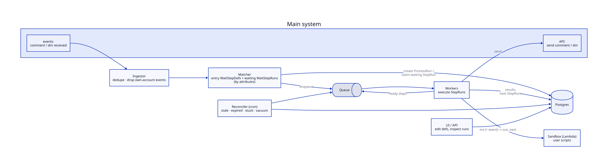
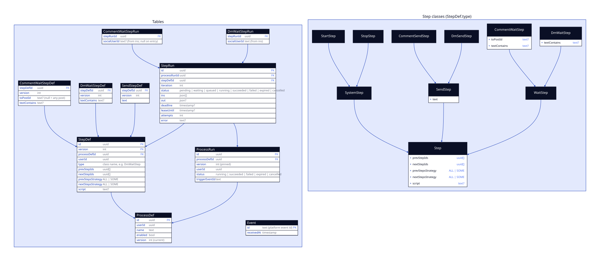
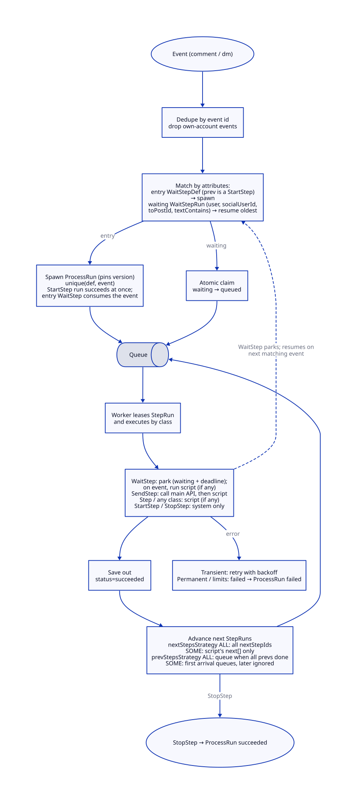

# Comment-triggered automations: backend design

Lets a user (our customer) build automations that start on a social media comment, e.g. *comment "pricing" on any post → reply "Sent you a DM!" → DM asking for an email → wait for the answer → DM a link*.

**Assumed contract (given by the main system):** events `Comment{id, fromSocialUserId, text, postId, ts}` and `Dm{id, fromSocialUserId, text, ts}`; calls to send a comment / DM. Events are scoped to the owning **user** (our customer); `userId` is implicit: set by the system on every row and query, never exposed to users or scripts. The remote person is a **socialUser**; `socialUserId` is visible and usable in scripts.

**Core idea:** an automation is a directed graph of steps. A matching event creates a *run*, a run persists its position in the DB, and wait steps simply park until a matching event arrives. Nothing holds a process open.

**Scope.** Basic version: predefined step classes configured declaratively. Main extension (the generality point of this design): any step may carry a script, i.e. user code run in a sandbox that maps input state to output state and can pick which outgoing edges to follow. There is no logic on edges.

## 1. Architecture



```d2
direction: right

main: Main system {
  ev: "events:\ncomment / dm received"
  api: "API:\nsend comment / dm"
}
ingest: "Ingestor\ndedupe · drop own-account events"
matcher: "Matcher\nentry WaitStepDefs + waiting WaitStepRuns\n(by attributes)"
db: Postgres {shape: cylinder}
queue: Queue {shape: queue}
worker: "Workers\nexecute StepRuns"
sandbox: "Sandbox (Lambda)\nuser scripts"
rec: "Reconciler (cron)\nstale · expired · stuck · vacuum"
ui: "UI / API\nedit defs, inspect runs"

main.ev -> ingest
ingest -> matcher
matcher -> db: "create ProcessRun /\nclaim waiting StepRun"
matcher -> queue: enqueue
queue -> worker
worker -> main.api: send
worker -> sandbox: "ins (+ event) → out, next"
worker -> db: "results,\nnext StepRuns"
worker -> queue: "ready steps"
rec -> db
rec -> queue
ui -> db
```

- **Ingestor** dedupes events and drops events authored by the user's own social account (our own "Sent you a DM!" comment must not re-trigger).
- **Matcher** selects steps by their existing attributes (see 2): entry wait steps to spawn a run, waiting StepRuns to resume one.
- **Workers** execute steps from a queue. Plain steps call the main system API; scripts run in a sandbox (Lambda or equivalent: isolated, no network, time/memory capped).
- **Reconciler** (periodic) repairs what events and the queue can't: stuck leases, expired waits, ready-but-not-enqueued steps; also vacuums unused versions.
- **UI/API** is a board where steps are nodes and `nextStepIds` / `prevStepIds` are edges, plus a run list. Beyond CRUD on definitions and read access to runs it is out of scope.
- Postgres + queue chosen to avoid a heavy dependency. Temporal / Step Functions is the natural upgrade at scale.

## 2. Data model



```d2
tables: Tables {
  ProcessDef: {
    shape: sql_table
    id: uuid {constraint: primary_key}
    userId: uuid
    name: text
    enabled: bool
    version: "int (current)"
  }
  StepDef: {
    shape: sql_table
    id: uuid {constraint: primary_key}
    version: int {constraint: primary_key}
    processDefId: uuid {constraint: foreign_key}
    userId: uuid
    type: "class name, e.g. DmWaitStep"
    prevStepIds: "uuid[]"
    nextStepIds: "uuid[]"
    prevStepsStrategy: "ALL | SOME"
    nextStepsStrategy: "ALL | SOME"
    script: "text?"
  }
  CommentWaitStepDef: {
    shape: sql_table
    stepDefId: uuid {constraint: foreign_key}
    version: int
    toPostId: "text? (null = any post)"
    textContains: "text?"
  }
  DmWaitStepDef: {
    shape: sql_table
    stepDefId: uuid {constraint: foreign_key}
    version: int
    textContains: "text?"
  }
  SendStepDef: {
    shape: sql_table
    stepDefId: uuid {constraint: foreign_key}
    version: int
    text: text
  }
  ProcessRun: {
    shape: sql_table
    id: uuid {constraint: primary_key}
    processDefId: uuid {constraint: foreign_key}
    version: "int (pinned)"
    userId: uuid
    status: "running | succeeded | failed | expired | cancelled"
    triggerEventId: text
  }
  StepRun: {
    shape: sql_table
    id: uuid {constraint: primary_key}
    processRunId: uuid {constraint: foreign_key}
    stepDefId: uuid {constraint: foreign_key}
    iteration: int
    status: "pending | waiting | queued | running | succeeded | failed | expired | cancelled"
    ins: "json[]"
    out: "json?"
    deadline: "timestamp?"
    leaseUntil: "timestamp?"
    attempts: int
    error: "text?"
  }
  CommentWaitStepRun: {
    shape: sql_table
    stepRunId: uuid {constraint: foreign_key}
    socialUserId: "text? (from ins; null on entry)"
  }
  DmWaitStepRun: {
    shape: sql_table
    stepRunId: uuid {constraint: foreign_key}
    socialUserId: "text (from ins)"
  }
  Event: {
    shape: sql_table
    id: "text (platform event id)" {constraint: primary_key}
    receivedAt: timestamp
  }

  StepDef.processDefId -> ProcessDef.id
  CommentWaitStepDef.stepDefId -> StepDef.id
  DmWaitStepDef.stepDefId -> StepDef.id
  SendStepDef.stepDefId -> StepDef.id
  ProcessRun.processDefId -> ProcessDef.id
  StepRun.processRunId -> ProcessRun.id
  StepRun.stepDefId -> StepDef.id
  CommentWaitStepRun.stepRunId -> StepRun.id
  DmWaitStepRun.stepRunId -> StepRun.id
}

hierarchy: "Step classes (StepDef.type)" {
  Step: {
    shape: class
    prevStepIds: "uuid[]"
    nextStepIds: "uuid[]"
    prevStepsStrategy: "ALL | SOME"
    nextStepsStrategy: "ALL | SOME"
    script: "text?"
  }
  SystemStep: {shape: class}
  StartStep: {shape: class}
  StopStep: {shape: class}
  SendStep: {shape: class; text: text}
  CommentSendStep: {shape: class}
  DmSendStep: {shape: class}
  WaitStep: {shape: class}
  CommentWaitStep: {shape: class; toPostId: "text?"; textContains: "text?"}
  DmWaitStep: {shape: class; textContains: "text?"}

  SystemStep -> Step: {target-arrowhead.shape: triangle}
  SendStep -> Step: {target-arrowhead.shape: triangle}
  WaitStep -> Step: {target-arrowhead.shape: triangle}
  StartStep -> SystemStep: {target-arrowhead.shape: triangle}
  StopStep -> SystemStep: {target-arrowhead.shape: triangle}
  CommentSendStep -> SendStep: {target-arrowhead.shape: triangle}
  DmSendStep -> SendStep: {target-arrowhead.shape: triangle}
  CommentWaitStep -> WaitStep: {target-arrowhead.shape: triangle}
  DmWaitStep -> WaitStep: {target-arrowhead.shape: triangle}
}
```

- **Step classes.** `StepDef.type` holds the class name. Joined-table inheritance: the base `StepDef` has what every step has (edges, strategies, script); each subclass table holds only its own attributes (`toPostId`, `textContains`, `text`). A plain `Step` is a script-only node.
- **Edges and strategies.** Edges are stored on both ends (`prevStepIds`, `nextStepIds`). `prevStepsStrategy`: `ALL` = run when all prevs succeeded, `SOME` = run on the first prev to arrive, later arrivals are ignored. `nextStepsStrategy`: `ALL` = follow all next edges, `SOME` = follow only those the script returns in `next`.
- **Versioned defs.** `StepDef` rows are immutable per `(id, version)`. Editing a process copies its graph as `version + 1` and bumps `ProcessDef.version`; a `ProcessRun` pins its version. The reconciler vacuums versions that are not current and have no non-terminal runs.
- **StepRuns are created lazily** as control reaches a step (loops make upfront creation impossible); a re-entered step gets `iteration + 1`. This also caps a run: max StepRuns per run.
- **State.** `ins[]` (one entry per prev, so joins have no merge conflicts) and a single `out`, both JSON-only with a size cap. With a script, `out` is what the script returns. Without one, `out = merge(ins) + own output` (a wait step adds the event, including its author's `socialUserId`).
- **socialUserId lives only where it belongs:** on wait step runs, set when the step parks, taken from `ins` (null on an entry `CommentWaitStep`, which accepts anyone). Runs themselves carry no social user.
- **Matching needs no artificial keys.** A comment or DM is matched against (a) entry wait steps: current-version defs whose prev is a `StartStep`, filtered by `userId`, `toPostId`, `textContains`; (b) waiting wait step runs, filtered by `userId` (via the run), `socialUserId`, and the def's `toPostId` / `textContains`. Indexes on those columns.
- Every top-level row carries `userId` (implicit, never user-supplied); every query is scoped by it.

## 3. Execution model



```d2
direction: down

event: "Event (comment / dm)" {shape: oval}
dedupe: "Dedupe by event id\ndrop own-account events"
match: "Match by attributes:\nentry WaitStepDef (prev is a StartStep)\n→ spawn\nwaiting WaitStepRun (user, socialUserId,\ntoPostId, textContains) → resume oldest"
spawn: "Spawn ProcessRun (pins version)\nunique(def, event)\nStartStep run succeeds at once;\nentry WaitStep consumes the event"
claim: "Atomic claim\nwaiting → queued"
queue: Queue {shape: queue}
run: "Worker leases StepRun\nand executes by class"
types: "WaitStep: park (waiting + deadline);\non event, run script (if any)\nSendStep: call main API, then script\nStep / any class: script (if any)\nStartStep / StopStep: system only"
save: "Save out\nstatus=succeeded"
adv: "Advance next StepRuns\nnextStepsStrategy ALL: all nextStepIds\nSOME: script's next[] only\nprevStepsStrategy ALL: queue when all prevs done\nSOME: first arrival queues, later ignored"
stop: "StopStep → ProcessRun succeeded" {shape: oval}
fail: "Transient: retry with backoff\nPermanent / limits: failed → ProcessRun failed"

event -> dedupe -> match
match -> spawn: entry
match -> claim: waiting
spawn -> queue
claim -> queue
queue -> run -> types
types -> save
types -> match: "WaitStep parks; resumes on\nnext matching event" {style.stroke-dash: 3}
types -> fail: error
save -> adv
adv -> queue
adv -> stop: StopStep
```

**Step classes.** `Step` (any step, optional `script`), `SystemStep` (`StartStep` records run info and proceeds; `StopStep` ends the run; neither has logic), `SendStep` (`CommentSendStep`, `DmSendStep`: `text`, addressed to the `socialUserId` in `ins`; a comment reply targets the trigger comment found in `ins`), `WaitStep` (`CommentWaitStep`, `DmWaitStep`: park until a matching event, then run the script if any).

**Script contract.** Input `ins` (plus the event for wait steps; both carry `socialUserId`), output `{out, next?}`. `next` is required when `nextStepsStrategy = SOME` and must be a subset of `nextStepIds` (empty ends that branch).

**Example:** `StartStep → CommentWaitStep(textContains="pricing") → CommentSendStep("Sent you a DM!") → DmSendStep("email?") → DmWaitStep` with a script that validates the email and `nextStepsStrategy = SOME`:
- *valid:* `next = [DmSendStep(link)]` → `StopStep`
- *invalid:* `next = [DmSendStep("invalid, try again")]` → back to the same `DmWaitStep` (its `prevStepsStrategy = SOME`, since it has two prevs).

**Spawning.** The entry `CommentWaitStep` is the trigger: a matching comment creates a `ProcessRun`, `StartStep` runs, and the entry wait step completes at once with the comment in `out`.

**Statuses.** StepRun: `pending` (waiting for join inputs) · `waiting` (parked for event) · `queued` · `running` · `succeeded` · `failed` · `expired` · `cancelled`. ProcessRun: `running` · `succeeded` · `failed` · `expired` · `cancelled`.

## 4. Important considerations

- **Concurrency.** An event resumes only the oldest matching waiting StepRun, claimed by an atomic conditional update (`... WHERE status='waiting' ... FOR UPDATE SKIP LOCKED LIMIT 1 RETURNING`), so two events can't advance one step twice. Run creation is unique on `(processDef, triggerEvent)`. Joins are conditional updates on `pending`.
- **Delivery.** Events and queue are at-least-once. Event dedupe via `Event`; steps are leased (`leaseUntil`) and re-run by the reconciler if a worker dies; sends use `stepRun.id` as idempotency key where the platform allows.
- **Timeouts.** Every wait has a `deadline`; on expiry the step and run become `expired`, so no orphans.
- **Failures.** Transient errors retry with backoff; permanent ones (blocked user, closed messaging window) fail the run; exhausted retries go to a dead-letter queue.
- **Abuse limits.** Max StepRuns per run, per-user quotas and rate limits, queue fair-share per user. Scripts: JSON in/out, size cap, wall-clock and memory cap, no network, no async APIs.
- **Isolation.** `userId` is on every top-level row and in every query, set by the system and never exposed to users or scripts; scripts only see `ins` and the event, which carry `socialUserId`.
- **Open (needs more elaboration):** `SOME` input strategy leaves losing branches running (cancel vs let finish); `ALL` input behavior when a prev fails; policy for the same socialUser triggering several concurrent runs; cron-type wait steps.
